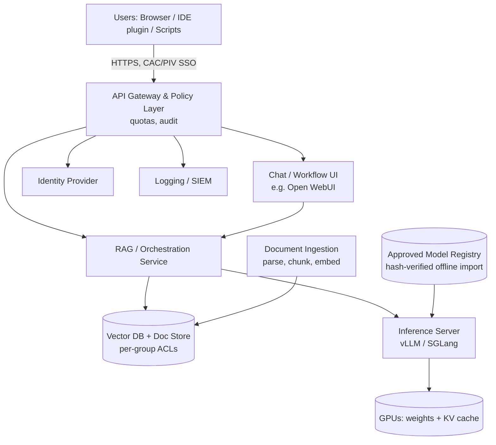

# Analysis of Alternatives (AoA): Budget-Constrained On-Premises LLM Platform for a CUI Environment

| Field | Value |
|---|---|
| Document status | DRAFT v0.2 – revised for a $15K–$55K hardware budget; base material for a future formal report |
| Date | 2026-10-16 |
| Prepared for | [Program / Department / Decision Authority] |
| Prepared by | [Author] |
| Supersedes | v0.1 (large-budget, $60K–$1.5M tiers) – archived in `archive_v1_large_budget/` |

> **Read first.** All prices, power, throughput and concurrency figures are **planning-grade estimates** (±25–40%) from public street pricing and published model characteristics. GPU and memory prices are volatile. Replace with vendor quotes and an on-site benchmark before any decision. Items in `[brackets]` are placeholders.

---

## 1. Executive Summary

The organization needs an LLM capability authorized for **Controlled Unclassified Information (CUI)** with a **large context window**, **simultaneous multi-user access**, and **workflow integration** (document analysis, RAG over internal repositories, code/script assistance, report drafting). The two in-house tools currently provided lack the functionality and context size for these workflows (see *Business Justification*).

Because the budget is limited, this revision focuses on **workstation-class Blackwell GPUs (96 GB each)** rather than data-center HGX systems. They offer the best memory-per-dollar for serving 100B-class models at long context, at roughly **$8–10K per 96 GB GPU** versus $30K+ per data-center GPU.

| Tier | Approx. hardware price | GPUs (VRAM) | Named users | Simultaneous active users |
|---|---|---|---|---|
| **1 – Pilot** | **~$15K** | 1 × 96 GB | 10–30 | 3–8 |
| **2 – Team** | **~$25K** | 2 × 96 GB (192 GB) | 25–75 | 8–20 |
| **3 – Production Team** | **~$35K** | 2 × 96 GB + separate app tier, storage, UPS | 30–100 | 8–20 |
| **4 – Division** | **~$45K** | 3 × 96 GB (288 GB) | 50–150 | 15–35 |
| **5 – Division+** | **~$55K** | 4 × 96 GB (384 GB) | 75–250 | 25–50 |

**Preliminary recommendation:** Purchase **Tier 3** (~$35K) using a **4-GPU-capable chassis**, so the system grows to Tier 4 and Tier 5 by adding about $9K per GPU as utilization demands. Tier 1 is suitable as a pilot/benchmark unit and later becomes the dev/test node. A compliant cloud LLM is the fallback (Alternative 2).

At these prices, **staff time dominates total cost**. Hardware is roughly $15–60K, but 0.25–0.5 FTE of operations effort is $30–60K per year (Section 7.1).

---

## 2. Problem Statement and Requirements

### 2.1 Operational Needs
- Process, summarize and query CUI documents (specs, test reports, contracts, procedures) without data leaving the authorization boundary.
- **Long-context workflows**: target ≥128K tokens per request.
- **Simultaneous use** by multiple people with acceptable latency.
- **API** for scripts and pipelines, not only a chat UI.
- **RAG** over controlled repositories with per-group access control.

### 2.2 Compliance Requirements (CUI)
| Area | Driver | Implication |
|---|---|---|
| Safeguarding | NIST SP 800-171 (Rev 2/3 per contract), 32 CFR Part 2002 | Access control, audit, encryption, boundary protection for every component |
| Contractual | DFARS 252.204-7012 / CMMC Level 2 (if applicable) | Cloud options must meet FedRAMP Moderate-equivalent and incident-reporting terms |
| Cryptography | FIPS 140-2/140-3 validated modules | FIPS-mode OS, encrypted disks, TLS 1.2+ |
| Identity | CAC/PIV or enterprise MFA, RBAC | OIDC/SAML integration |
| Audit | Who asked what; which documents were retrieved | Logs forwarded to SIEM |
| Supply chain | Model provenance; hardware sourcing | Approved-model list; hash-verified import; TAA/Section 889 hardware (see 6.4) |
| Export | ITAR/EAR data may be present | On-prem avoids foreign-hosted data; U.S.-person access control |
| Network | Air-gapped or enclave-only | Offline import of models/packages; internal mirrors |
| Authority | ATO / System Security Plan | Plan authorization effort |

### 2.3 Key Assumptions (validate)
1. Named users: [N]. Peak simultaneous *active* requests ≈ 10–20% of named users.
2. Typical prompt 4–16K tokens (with RAG); long jobs up to 128K.
3. Typical response 300–1,500 tokens.
4. Targets: time-to-first-token < 3 s (short prompt), < 20 s (128K prompt); ≥ 15–20 tokens/s per user streaming.
5. A controlled room/rack with a 208/240 V 20–30 A circuit is available.
6. Open-weight models are permitted after security review.

---

## 3. Evaluation Criteria

| Criterion | Weight |
|---|---|
| CUI compliance / data control | 25% |
| Capability (model quality, context size) | 20% |
| Concurrency / scalability | 15% |
| Total cost of ownership (3 yr) | 15% |
| Time to capability (incl. ATO) | 10% |
| Integration & customization | 10% |
| Operational risk | 5% |

---

## 4. Alternatives Considered

| # | Alternative | Disposition |
|---|---|---|
| 0 | **Status quo** – two existing in-house tools | Baseline. No new cost; capability and context gaps persist; limited API/RAG. |
| 1 | **Commercial public SaaS** | **Eliminated** – not suitable for CUI. |
| 2 | **Government/compliant cloud LLM** (e.g., Azure OpenAI in Azure Government, AWS Bedrock GovCloud) | Viable. Fast, strong models, no hardware. Cost scales with long-context use; data leaves the site; contract/boundary review needed. Est. **$0.1M–$0.6M over 3 yr** for this user population (usage-driven; verify current pricing). |
| 3 | **On-prem self-hosted open-weight LLM (Tiers 1–5)** | Detailed in Section 6. Est. **$27K–$143K over 3 yr excluding staff labor.** |
| 4 | **Hybrid** – on-prem for CUI, cloud for non-CUI | Possible later; needs a routing policy and adds mis-routing risk. |

**Below Tier 1 (not recommended for production):** small unified-memory systems (e.g., NVIDIA DGX Spark-class, AMD Strix Halo mini PCs, ~$2–5K) can run large models for one developer, but memory bandwidth is roughly 6–7× lower than a 96 GB workstation GPU, so they do not serve several simultaneous users well. Useful only for single-user prototyping with non-sensitive data.

---

## 5. Proposed System Concept (High-Level)

### 5.1 Logical Architecture

In Tiers 1–2 the gateway, UI, RAG and vector DB run as containers on the same machine as the GPUs. From Tier 3 up they run on a separate app/data server, which keeps retrieval, logs and user data off the inference host and simplifies security boundaries and backup.

### 5.2 Software Stack (self-hosted, no outbound connectivity)
| Layer | Candidates | Purpose |
|---|---|---|
| OS | RHEL/Rocky/Ubuntu Pro, FIPS mode, STIG-hardened; Docker or Kubernetes (k3s) | Hardened base |
| Inference engine | vLLM or SGLang (TensorRT-LLM optional) | Continuous batching, paged KV cache, prefix caching |
| Gateway | LiteLLM / NGINX with OIDC | OpenAI-compatible API, per-user quotas |
| UI | Open WebUI or similar | Chat, uploads, shared prompts |
| RAG | Open embedding model + reranker; pgvector/Qdrant | Cited answers with ACL enforcement |
| Observability | Prometheus, Grafana, DCGM exporter | Utilization, latency, tokens |
| Security | Full-disk encryption, TPM, secrets vault, SIEM forwarder, vulnerability scanning | 800-171 controls |
| Fine-tuning (Tier 4–5, optional) | PEFT/LoRA | Domain adaptation of small/mid models |

### 5.3 Model Selection Approach
Use a **portfolio** sized to the tier:

| Role | Candidate classes (verify current versions, licenses, provenance) | Approx. weights memory |
|---|---|---|
| General assistant / reasoning | OpenAI gpt-oss-120b (MoE, Apache 2.0, ~5B active parameters) | ~63 GB (4-bit MXFP4) |
| General assistant (mid) | Llama 3.x 70B, Gemma 27B, Mistral Small/Medium class, NVIDIA Nemotron | 15–40 GB (4-bit) to 70 GB (FP8) |
| Large MoE (Tier 5 only) | Llama 4 Maverick-class (~400B total) at 4-bit | ~200–220 GB |
| Coding | The general model above or a code-tuned variant | – |
| Embeddings + reranker | Small open models | 1–4 GB |

**Provenance policy:** Assumes **U.S./allied-origin models only**. Many organizations prohibit models from foreign-adversary developers on government-related systems regardless of license. Download on an internet-connected system, scan, hash-verify, store as `safetensors` (no pickle), and import through the approved transfer process. Legal review of each license is required.

Mixture-of-Experts (MoE) models such as gpt-oss-120b are especially well suited to this budget: only ~5B parameters are active per token, so a single 96 GB GPU can serve many users quickly, and the KV cache per token is small.

### 5.4 How Multiple Users Share One System
1. **Continuous batching:** the inference engine interleaves many users' requests token by token, so one loaded model copy serves everyone at once.
2. **Paged KV cache:** each active conversation uses GPU memory proportional to its context length; memory is usually the limit for long-context use (Section 6.2).
3. **Prefix caching:** shared system prompts and repeated documents are cached.
4. **Quotas and priority:** the gateway enforces per-user/team token budgets and prioritizes interactive over batch use.
5. **Isolation:** conversations and RAG indices are partitioned by user/group ACLs; logging is per user.
6. **Batch queue:** large offline jobs run at off-peak hours.
7. **Scaling path:** add GPUs (and later a second node) behind the same gateway with no user-facing change.

---

## 6. On-Premises Price Tiers and Hardware

### 6.1 Tier Summary

> Hardware price estimates, USD, excluding tax/shipping. Based on ~$8–10K per RTX PRO 6000 Blackwell 96 GB (Max-Q, 300 W) at street pricing. Government-channel (TAA-compliant OEM) pricing is often 15–40% higher; see 6.4.

| | **Tier 1** | **Tier 2** | **Tier 3** | **Tier 4** | **Tier 5** |
|---|---|---|---|---|---|
| Role | Pilot / dev | Team | Production team | Division | Division+ |
| **Hardware price** | **~$15K** ($13–17K) | **~$25K** ($23–29K) | **~$35K** ($33–40K) | **~$45K** ($43–52K) | **~$55K** ($53–62K) |
| GPUs | 1 | 2 | 2 | 3 | 4 |
| Total GPU memory | 96 GB | 192 GB | 192 GB | 288 GB | 384 GB |
| Platform | Workstation tower | 4-GPU-capable workstation/server | 4-GPU-capable server + separate app/data server | Same as Tier 3 | Same as Tier 3 |
| System RAM | 128–256 GB | 256–512 GB | 256–512 GB + 64 GB app server | 512 GB | 512 GB |
| Storage (NVMe) | 4–8 TB | 8–16 TB | 8–16 TB + backup NAS | 16 TB + backup | 16–32 TB + backup |
| Network | 10 GbE | 10/25 GbE | 10/25 GbE, firewall/switch | 25 GbE | 25 GbE |
| UPS | Small (1.5 kVA) | 3 kVA | 3 kVA | 3 kVA | 3–5 kVA |
| Typical model deployment | gpt-oss-120b **or** a 27–70B 4-bit model; embeddings alongside | Two replicas of gpt-oss-120b (≈2× throughput) **or** one 70B FP8 across 2 GPUs | Same as Tier 2 | 2 GPUs: main model; 1 GPU: fast small model + embeddings/reranker + document parsing | 4 GPUs: main model(s) with large KV cache, **or** a ~400B-class MoE at 4-bit |
| Max context | 128K (few sessions) | 128K | 128K | 128K–256K | 128K–256K+ |
| Named users | 10–30 | 25–75 | 30–100 | 50–150 | 75–250 |
| Simultaneous active users* | 3–8 | 8–20 | 8–20 | 15–35 | 25–50 |
| System power at load | ~0.8–1.0 kW | ~1.3–1.6 kW | ~1.5–2.0 kW | ~1.8–2.4 kW | ~2.0–2.6 kW |
| Facility | Office/lab, 20 A circuit | 208/240 V 20 A recommended | Rack/cabinet, 208/240 V 20 A | Rack, 208/240 V 20–30 A | Rack, 208/240 V 30 A |
| Redundancy | None | None | Cold spares; backup of data tier | Cold spares | Cold spares |
| Fine-tuning | None | Small LoRA (≤30B) | Small LoRA (≤30B) | LoRA ≤70B | LoRA ≤70B |
| One-time integration/ATO effort | $5–15K | $8–20K | $15–35K | $20–40K | $25–45K |
| Annual non-labor opex** | $3–5K | $4–7K | $5–9K | $6–10K | $7–12K |
| **3-yr TCO excl. staff labor** | **$27–47K** | **$43–70K** | **$63–102K** | **$81–122K** | **$99–143K** |

\* Simultaneous *active* = requests generating at the same moment; ≈10–20% of named users in typical office use. Ranges are estimates and must be benchmarked.
\** Support/warranty extension, OS/software subscriptions, power and cooling.
Staff labor (0.25–0.5 FTE ≈ $30–60K/yr, i.e., $90–180K over 3 years) is excluded here and counted in the Business Justification.

**Notes on the ladder**
- **Tier 1→2** doubles GPU memory and allows either 2× throughput or larger models.
- **Tier 2→3** adds **no GPU capacity**; it adds production-grade separation (dedicated app/data server, backup, logging, firewall/switch). Skip it if the security office accepts co-hosting the app stack on the GPU host (saves ~$10K).
- **Tier 3→4→5** adds one GPU (~$9K) at a time. Buying the 4-GPU-capable chassis, 1600–2000 W PSU(s) and sufficient PCIe lanes/RAM at Tier 3 avoids re-purchasing the platform.
- Data-center HGX systems (H200/B200, $300K+) are out of scope at this budget.

### 6.2 Sizing Logic

**Weights memory** = parameters × bytes/parameter (FP16 = 2, FP8 = 1, 4-bit ≈ 0.5) plus ~10% overhead.
**KV-cache per token** = 2 × layers × KV-heads × head-dim × bytes/element.

**Example 1 – gpt-oss-120b (Tier 1, 96 GB).** Approximate architecture: 36 layers, 8 KV heads, head-dim 64, half the layers use a short sliding window, so only ~18 layers cache full context. In BF16, KV ≈ 2 × 18 × 8 × 64 × 2 B ≈ **~37 KB/token**.
- 128K-token session ≈ **~4.7 GB**.
- Memory budget: 96 × 0.9 ≈ 86 GB − ~63 GB weights ≈ **~23 GB for KV** → about **5 simultaneous 128K sessions**, or ~**70+ sessions at 8K context**.
- Compute is typically the limit before memory for short prompts, hence the 3–8 active-user estimate for one GPU.

**Example 2 – 70B dense model, FP8 (Tier 2, 192 GB).** 80 layers, 8 KV heads, head-dim 128, FP8 KV: 2 × 80 × 8 × 128 × 1 B ≈ **160 KB/token** (~21 GB per 128K session).
- 192 × 0.9 ≈ 173 GB − 70 GB weights ≈ 103 GB → ~**5 full-128K sessions**, or ~**80 at 8K**.
- A MoE model is therefore far more efficient per dollar for long-context, multi-user serving than a dense 70B model.

$$\text{Concurrent sessions} \approx \frac{\text{GPU memory} \times 0.9 - \text{weights}}{\text{avg context tokens} \times \text{KV bytes/token}}$$

**Throughput (order of magnitude):** an RTX PRO 6000 Blackwell has ~1.8 TB/s memory bandwidth. A small-active-parameter MoE model on one such GPU can sustain on the order of **1,000–3,000 aggregate output tokens/s** under batching, i.e., 15–30 tokens/s each for ~5–15 simultaneous streams. Dense 70B models are several times slower. **Benchmark the actual model and real prompts before purchase.**

**Multi-GPU note:** these workstation GPUs communicate over PCIe (no NVLink). That is fine for serving: running one replica per GPU needs no inter-GPU traffic, and tensor parallelism across 2–4 GPUs works with moderate overhead.

### 6.3 Reference Bill of Materials (planning estimates)

| Component | Tier 1 | Tier 2 | Tier 3 | Tier 4 | Tier 5 |
|---|---|---|---|---|---|
| RTX PRO 6000 Blackwell 96 GB (Max-Q) | 1 × ~$9K | 2 × ~$9K = $18K | $18K | 3 × ~$9K = $27K | 4 × ~$9K = $36K |
| GPU host (CPU, board, RAM, PSU, chassis, NVMe) | $4–6K (tower, 16–24 cores, 128–256 GB) | $6–9K (8–16-core+ workstation/server, 256–512 GB) | $9–11K (4-GPU-capable server, 256–512 GB) | $10–13K | $11–14K |
| App/RAG/gateway server | on GPU host | on GPU host | $3–4K | $3–4K | $3–4K |
| Backup NAS / storage | – | – | $2–3K | $2–4K | $2–4K |
| Network (switch, firewall) | – | $0.5–1K | $1–2K | $1–2K | $1–2K |
| UPS | $0.5K | $1K | $1.5K | $1.5K | $2K |
| OS subscription, TPM, misc. | ~$1K | ~$1K | ~$1.5K | ~$1.5K | ~$1.5K |
| **Approx. total** | **~$15K** | **~$25K** | **~$35K** | **~$45K** | **~$55K** |

### 6.4 Procurement Considerations
- **TAA / Section 889 / NDAA compliance:** many government and contractor buyers must purchase TAA-compliant, authorized-channel hardware. White-box builds may not be allowed; OEM workstations/servers (Dell, HPE, Lenovo, Supermicro via authorized resellers) often cost 15–40% more than the street-price estimates above. If so, expect each tier to cost 15–40% more or shift one tier down in capability.
- **Memory (DRAM) price volatility:** server RAM pricing has been unstable; quote early and consider less RAM at purchase with expansion later.
- **Power and cooling:** four 300 W GPUs plus CPUs in one chassis produce ~2 kW; ensure room cooling and a dedicated circuit. Max-Q (300 W) cards are used for better density than 600 W Workstation Edition cards.
- **Warranty:** 3-year on-site where available; hold spare parts for the GPU and PSU if the system is mission-critical.
- **Media sanitization:** plan for retaining failed drives (CUI) rather than returning them.
- **Lead time:** confirm GPU availability with vendors.
- **Obsolescence:** plan for 3–5 years of use; the model layer is replaceable without hardware change.

---

## 7. Comparative Analysis

### 7.1 Cost Perspective
- Hardware is **$15K–$55K**, but **staff time to operate** (updates, model changes, security patching, user support) is 0.25–0.5 FTE, which exceeds hardware cost within the first year. Budget for it explicitly or assign a named owner.
- One-time integration/ATO effort ($5–45K, mostly internal labor) is the second-largest element.

### 7.2 Scoring (1 = poor, 5 = excellent; illustrative—revise with stakeholders)

| Criterion (weight) | Alt 0 | Alt 2 Cloud | T1 | T2 | T3 | T4 | T5 |
|---|---|---|---|---|---|---|---|
| CUI compliance / control (25%) | 4 | 3 | 5 | 5 | 5 | 5 | 5 |
| Capability / context (20%) | 1 | 5 | 3 | 3 | 4 | 4 | 4 |
| Concurrency / scalability (15%) | 2 | 5 | 1 | 2 | 2 | 3 | 4 |
| 3-yr TCO (15%) | 5 | 3 | 5 | 5 | 4 | 4 | 3 |
| Time to capability (10%) | 5 | 3 | 4 | 4 | 3 | 3 | 3 |
| Integration & customization (10%) | 1 | 3 | 4 | 4 | 5 | 5 | 5 |
| Operational risk (5%) | 3 | 4 | 2 | 2 | 3 | 3 | 3 |
| **Weighted score** | **3.00** | **3.75** | **3.65** | **3.80** | **3.90** | **4.05** | **4.05** |

Interpretation: Tiers 3–5 score highest; Tier 3 has the best score per dollar and leaves a path to Tiers 4–5. Tier 1 is adequate for proof-of-concept but weak on concurrency and resilience. Cloud is competitive but sensitive to usage growth and CUI contract/risk acceptance.

### 7.3 Break-Even: On-Prem vs. Cloud (illustrative, excludes staff labor for both)
$$\text{Break-even (months)} = \frac{\text{On-prem upfront cost}}{\text{Monthly cloud cost} - \text{Monthly on-prem non-labor opex}}$$

Tier 3 upfront ≈ $36K hardware + $25K integration = $61K; monthly on-prem non-labor opex ≈ $0.6K. If cloud usage reaches $4K/month: $61K / ($4K − $0.6K) ≈ **18 months**. At light use ($1.5K/month) the break-even is ~68 months, so **cloud is cheaper at light use**. Usage profiling from the pilot should drive the decision. If the long-context/RAG/agentic workloads are heavy, on-prem wins; if usage stays light, cloud wins.

### 7.4 Capability Notes
- Open-weight models in 2026 handle most enterprise tasks (summarization, extraction, drafting, scripting) well but may trail the best proprietary models on the hardest reasoning and agentic tasks.
- At this budget the largest practical models are ~120B (Tiers 1–4) and a 4-bit ~400B MoE (Tier 5). Quantization lowers quality slightly; validate against workflows.
- Long-context quality degrades with length; use RAG and chunking strategies instead of relying on raw 128K prompts for everything.

---

## 8. Risk Assessment

| Risk | L | I | Mitigation |
|---|---|---|---|
| Hardware must be TAA-compliant, raising cost 15–40% | H | M | Confirm sourcing rules early; get OEM quotes alongside white-box |
| ATO/authorization delays | M | H | Engage ISSO/ISSM early; reuse hardened baselines |
| Single point of failure (no HA at this budget) | H | M | Cold spares, backups of data tier, cloud contingency, documented recovery |
| Under-sizing as adoption grows | M | M | Quotas, queueing, instrumented pilot; add GPUs at 70% sustained utilization |
| Staffing/skills gap | M | H | Named owner, training, runbooks; budget labor explicitly |
| GPU supply/price volatility | M | M | Early quotes; accept equivalent SKUs |
| Model license/provenance concern | L–M | H | Legal review; approved-model list |
| Hallucination / misuse | H | M | Citations, human review, acceptable-use policy |
| Data leakage between users | L | H | Per-group ACLs, per-tenant indices, red-team tests |
| Prompt injection via documents | M | M | Input sanitization; tool-permission scoping; no autonomous external actions |
| Facility power/cooling in office-type space | M | M | Site check; 208/240 V circuit; adequate ventilation (noise and heat) |

---

## 9. Implementation Roadmap (Recommended)

| Phase | Activities | Output |
|---|---|---|
| 0. Discovery | Confirm user counts, workflows, document volumes, sourcing rules (TAA), policy on open-weight models, facility check | Validated requirements |
| 1. Pilot / benchmark | Buy or borrow a Tier 1 unit (or use a temporary compliant cloud with non-sensitive data); benchmark 2–3 candidate models on representative prompts; compare with the current tools | Throughput/latency/quality data; tier decision |
| 2. Procurement + ATO prep | Quotes, PO, SSP, STIG baselines, model import procedure | Approved design |
| 3. Deploy Tier 3 | Install, harden, integrate IdP/logging/RAG; 20–40 pilot users | Initial Operating Capability |
| 4. Expand | Add GPUs (Tier 4→5) as triggers fire; add workflows | Full Operating Capability |
| 5. Sustain | Quarterly model refresh, security review, usage reporting; reuse Tier 1 pilot unit as dev/test | Continuous improvement |

**Expansion triggers:** sustained GPU utilization > 70%, p95 time-to-first-token above target, or queue wait > 10 s.

---

## 10. Decision Requested and Open Items

**Decision requested:** Approve ~$35K (hardware) plus integration effort to proceed with Phase 0–3 at Tier 3, with a defined path to Tier 5 (+~$20K), conditional on pilot validation. Alternatively approve the ~$15K Tier 1 pilot first.

**Open items**
1. Named-user count and workflow inventory by department.
2. CUI categories in scope (incl. export-controlled); contract-specific restrictions.
3. Hardware sourcing rules (TAA/889; OEM vs. white-box) and the effective price uplift.
4. Policy on open-weight/model-origin; whether cloud CUI processing is allowed at all.
5. Facility readiness (power, cooling, noise, physical access).
6. Current in-house tool names, costs, context limits and usage stats.
7. Who operates the platform and what share of time they can dedicate.
8. Funding profile (CapEx vs. OpEx) and procurement vehicle.
9. At least two vendor quotes per tier.

## 11. Glossary
**CUI** Controlled Unclassified Information · **RAG** Retrieval-Augmented Generation · **KV cache** attention key/value memory per token · **MoE** Mixture of Experts · **ATO** Authority to Operate · **SSP** System Security Plan · **TCO** Total Cost of Ownership · **TAA** Trade Agreements Act · **LoRA** Low-Rank Adaptation · **FIPS** Federal Information Processing Standard · **STIG** Security Technical Implementation Guide · **TP** Tensor Parallelism

## 12. Reference Topics to Cite in Final Report (verify current versions)
- NIST SP 800-171 (Rev 2/3), 800-171A, 800-53; NIST AI RMF 1.0
- 32 CFR Part 2002 (CUI); DFARS 252.204-7012; CMMC (32 CFR Part 170)
- NDAA Section 889; Trade Agreements Act
- Vendor datasheets: NVIDIA RTX PRO 6000 Blackwell; OEM workstation/server specifications
- Model cards and licenses for each candidate model
- vLLM / SGLang documentation
