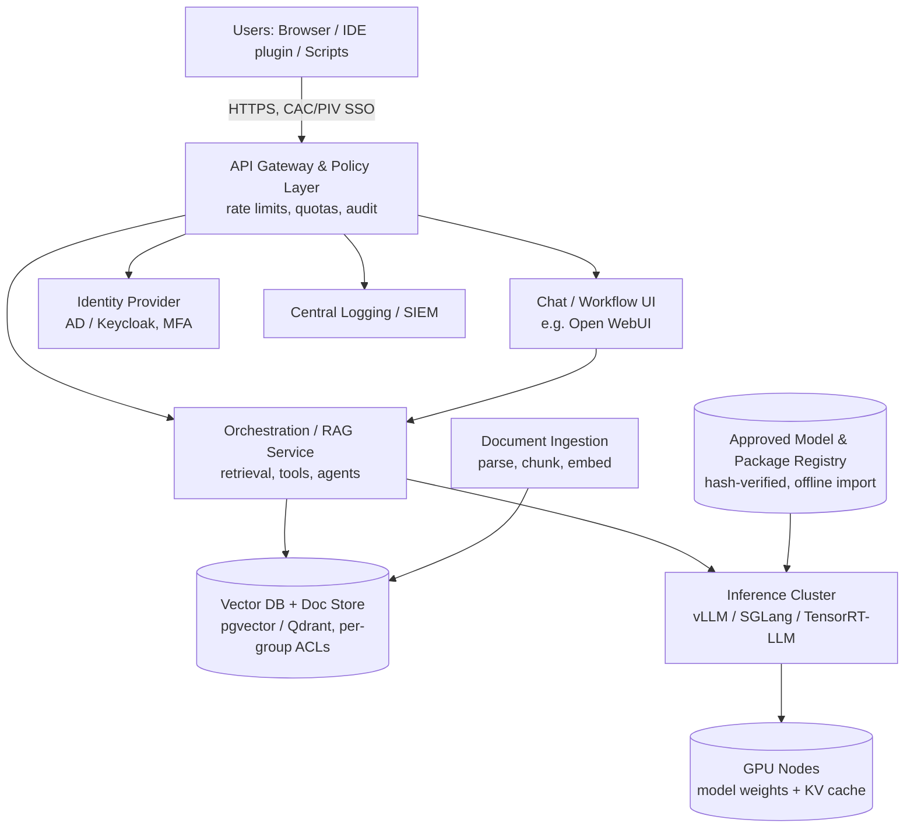

# Analysis of Alternatives (AoA): Enterprise On-Premises LLM Platform for a CUI Environment

| Field | Value |
|---|---|
| Document status | DRAFT v0.1 – base material for a future formal report |
| Date | 2026-10-14 |
| Classification of this document | Unclassified (contains no CUI; verify before distribution) |
| Prepared for | [Program / Department / Decision Authority] |
| Prepared by | [Author] |

> **Important – read first.** All prices, power figures, throughput and concurrency numbers in this document are **planning-grade estimates** (typically ±25–40%) based on publicly known list/street pricing and published model characteristics. They must be replaced with vendor quotes and an on-site benchmark before any procurement decision. Items in `[brackets]` are placeholders to fill in.

---

## 1. Executive Summary

The organization needs a generative-AI / LLM capability that can process **Controlled Unclassified Information (CUI)** with a **large context window**, **multi-user concurrency**, and **workflow integration** (document analysis, RAG over internal repositories, code/script assistance, report drafting). The two currently provided in-house tools are limited in functionality and context size and cannot support the intended workflows (see companion document: *Business Justification*).

This AoA compares five alternatives and four on-premises price tiers:

| # | Alternative | Summary | Rough Cost (3-yr TCO) |
|---|---|---|---|
| 0 | Status quo (two existing in-house tools) | No new spend; functional/context limits persist | $[existing license cost] |
| 1 | Commercial SaaS LLM (public tenant) | Fast, best models, **not suitable for CUI** | Not eligible |
| 2 | Government/compliant cloud LLM (e.g., Azure OpenAI in Azure Government, AWS Bedrock in GovCloud, FedRAMP High/Moderate + DFARS 7012 compliant) | Fastest compliant path; recurring consumption cost; data leaves site | $0.3M – $2M+ (usage-driven) |
| 3 | **On-premises, self-hosted open-weight LLM (Tiers A–D below)** | Full data control, fixed cost, air-gap capable, customizable | $0.15M – $2.5M |
| 4 | Hybrid (on-prem for CUI, compliant cloud for burst/non-CUI) | Flexibility; more complexity | Tier cost + cloud usage |

**Recommendation (preliminary):** Alternative 3 at **Tier B (Division) as the initial deployment**, architected to scale to Tier C by adding a second node, with Alternative 2 retained as a contingency. Tier B provides roughly 40–80 simultaneous active users with 128K-token context on a 70–120B-class model for approximately **$200K–$300K capital** plus integration/operating costs. The final tier should be set by the validated named-user count (Section 6).

---

## 2. Problem Statement and Requirements

### 2.1 Mission/Operational Needs
- Process, summarize and query CUI documents (specs, test reports, contracts, ICDs, procedures) without data leaving the authorization boundary.
- Support **long-context workflows**: multi-document analysis, large codebases/scripts, long reports (target ≥128K tokens per request; stretch 256K+).
- Support **many simultaneous users** with acceptable latency.
- Provide an **API** so engineers can integrate the model into scripts, pipelines and tools, not just a chat UI.
- Support **RAG** over controlled document stores, with per-user/per-group access enforcement.
- Enable **fine-tuning / adaptation** (LoRA) on internal data in higher tiers.

### 2.2 Compliance Requirements (CUI)
| Area | Requirement / Driver | Implication |
|---|---|---|
| Safeguarding | NIST SP 800-171 (Rev 2 or Rev 3 per contract), 32 CFR Part 2002 | Access control, audit, encryption, boundary protection for all components |
| Contractual | DFARS 252.204-7012 / CMMC Level 2 (if DoD contractor) | If cloud used, FedRAMP Moderate-equivalent and incident reporting terms apply |
| Cryptography | FIPS 140-2/140-3 validated modules | FIPS-mode OS, disk encryption (e.g., SED/LUKS with FIPS), TLS 1.2+/FIPS |
| Identity | CAC/PIV or enterprise MFA, SSO, RBAC/ABAC | OIDC/SAML integration (Keycloak/Entra/AD FS) |
| Audit | Log who asked what, which documents were retrieved | Central tamper-evident logging to SIEM |
| Supply chain | Model provenance, no foreign-adversary-origin models where prohibited (see 5.3) | Approved-model list and hash-verified import process |
| Export | ITAR/EAR data may be present | U.S.-person access control; on-prem avoids foreign-hosted data |
| Network | Air-gapped or enclave-only | Offline model/package import ("sneakernet"/data diode process), internal mirrors |
| Authority | ATO / system security plan (SSP) | Plan for authorization time and documentation effort |

### 2.3 Key Assumptions (validate)
1. User population: [N named users]; peak simultaneous *active* requests ≈ 10–20% of named users.
2. Typical prompt: 4–16K tokens (with RAG); long-context jobs up to 128K tokens.
3. Typical response: 300–1,500 tokens.
4. Acceptable latency: time-to-first-token < 3 s (short prompt), < 15 s (128K prompt); ≥ 20 tokens/s per user streaming.
5. A facility with power, cooling and a controlled room/rack exists or can be provisioned.
6. Open-weight models are permitted by policy after security review.

---

## 3. Evaluation Criteria

| Criterion | Weight | Notes |
|---|---|---|
| CUI compliance / data control | 25% | Pass/fail gate plus degree of control |
| Capability (model quality, context size) | 20% | Reasoning, coding, long-context accuracy |
| Concurrency / scalability | 15% | Simultaneous users, growth path |
| Total cost of ownership (3–5 yr) | 15% | CapEx + OpEx + staff |
| Time to capability (incl. ATO) | 10% | Procurement lead times, authorization |
| Integration & customization | 10% | API, RAG, fine-tuning, workflow tooling |
| Operational risk & sustainability | 5% | Staffing, vendor lock-in, obsolescence |

---

## 4. Alternatives Considered

### Alternative 0 – Status Quo (two existing in-house tools)
- **Pros:** No new cost; already authorized; familiar to users.
- **Cons:** Limited functionality, small context windows, cannot support target workflows; [rate/usage limits]; limited API/automation; no control over model or roadmap.

### Alternative 1 – Commercial Public SaaS
- **Disposition: Eliminated.** Public tenants do not meet CUI handling requirements. Documented here only for completeness.

### Alternative 2 – Compliant Cloud (Government Cloud-Hosted LLM)
- **Pros:** No hardware, access to frontier models, quick to scale, minimal ops burden.
- **Cons:** Recurring, usage-based cost that scales with adoption; CUI leaves the physical site (acceptable only with correct FedRAMP/DFARS posture and contract flow-down); model-availability/region constraints; vendor deprecation cycles; data-residency and ITAR review; internet/egress dependence; limited ability to fine-tune/inspect.
- **Cost model:** ≈ tokens × price. Example: 100 users × 200K tokens/day × 250 days = 5B tokens/yr. At a blended $3–$10 per million tokens that is **$15K–$50K/yr for light use**, but long-context agentic and RAG workflows often consume 10–50× more, pushing cost to **$150K–$2M+/yr**. Verify current government-region pricing.

### Alternative 3 – On-Premises Self-Hosted Open-Weight LLM (Four Tiers)
Detailed in Section 6.

### Alternative 4 – Hybrid
- CUI workloads on on-prem platform; non-CUI/public-information tasks on a compliant cloud or a lower-cost service. Requires a policy gateway that classifies and routes requests (and a user-facing rule set), which adds complexity and a risk of mis-routing.

---

## 5. Proposed System Concept (High-Level)

### 5.1 Logical Architecture

### 5.2 Software Stack (all self-hosted, no outbound connectivity)
| Layer | Candidate Components | Purpose |
|---|---|---|
| OS / Platform | RHEL/Rocky/Ubuntu Pro (FIPS mode, STIG-hardened), Kubernetes or Slurm/Docker | Hardened base, workload scheduling |
| Inference engine | vLLM, SGLang, or NVIDIA TensorRT-LLM / Triton | Continuous batching, paged KV cache, prefix caching, tensor/expert parallelism |
| Gateway | LiteLLM / Envoy / NGINX with OIDC | OpenAI-compatible API, per-user quotas, logging |
| User interface | Open WebUI or similar | Chat, document upload, shared prompts, workspaces |
| RAG | Embedding model + reranker, pgvector/Qdrant/OpenSearch | Grounded answers on internal docs with ACL enforcement |
| Orchestration | LangGraph/LlamaIndex or in-house | Multi-step workflows, tool use |
| Observability | Prometheus, Grafana, DCGM exporter, Loki | GPU utilization, latency, token metrics |
| Security | FIPS crypto, SED/LUKS, Vault/HSM for secrets, SIEM forwarder, vuln scanning | 800-171 controls |
| Fine-tuning (Tier C/D) | PEFT/LoRA, Axolotl/Unsloth, MLflow | Domain adaptation |

### 5.3 Model Selection Approach
Use a **portfolio** rather than a single model:

| Role | Candidate classes (verify current versions, licenses and provenance) | Typical size |
|---|---|---|
| General reasoning / assistant | OpenAI gpt-oss (120B MoE, Apache 2.0), Meta Llama 3.x/4 family, Mistral models (check license terms), NVIDIA Nemotron, Google Gemma | 27B – 400B |
| Coding assistant | Code-tuned variants or the general model above | 30B – 120B |
| Embeddings + reranker | Open embedding models (e.g., BGE/E5/Nomic-class) | < 1B |
| Small/fast model (routing, classification, summarization) | 8B–27B class | 8–27B |

**Provenance policy:** Many organizations bar models developed by entities in foreign-adversary countries (e.g., certain Chinese-origin model families) from government-related systems, regardless of open licenses. This AoA assumes **U.S./allied-origin models only**, subject to security and legal review. Models should be downloaded on an internet-connected system, scanned, **hash-verified, stored in `safetensors` format (no pickle)**, and imported through the approved transfer process. Confirm each license's terms for commercial/government use.

### 5.4 How Multiple Users Share One System
1. **Continuous batching:** The inference engine interleaves many users' requests token-by-token on the same GPUs, so one model copy serves many people at once. Throughput rises with load; per-user speed degrades gradually.
2. **Paged KV cache:** Each active conversation consumes GPU memory proportional to its context length (see 6.2). Memory, not compute, is typically the concurrency limit for long-context use.
3. **Prefix caching:** Shared system prompts, templates and repeated documents are cached, lowering latency and cost for common workflows.
4. **Quotas and priority:** The gateway applies per-user/per-team token budgets and priority classes (e.g., interactive > batch), so a bulk job cannot starve interactive users.
5. **Isolation:** Conversations and RAG indices are partitioned by user/group ACLs; logs are per-user for audit. Models are stateless between requests.
6. **Batch queue:** Large offline jobs (summarize 5,000 documents) run in off-peak windows.
7. **Scaling path:** Add GPU nodes behind the same gateway; no user-facing change.

---

## 6. On-Premises Price Tiers and Hardware

### 6.1 Tier Summary

> Costs are 2026 planning estimates, USD, including taxes/shipping excluded. GPU pricing and availability are volatile; request quotes.

| | **Tier A – Team** | **Tier B – Division (recommended start)** | **Tier C – Enterprise** | **Tier D – Enterprise HA + Training** |
|---|---|---|---|---|
| Target named users | 25–100 | 100–400 | 400–1,500 | 1,500–5,000+ |
| Peak simultaneous active users* | 5–20 | 20–80 | 80–250 | 250–800 |
| Accelerators | 2× NVIDIA RTX PRO 6000 Blackwell (96 GB) | 4× NVIDIA RTX PRO 6000 Blackwell (96 GB) | 8× NVIDIA H200 (141 GB) HGX node | 2× HGX B200 nodes (8× ~180 GB each) |
| Total GPU memory | 192 GB | 384 GB | 1,128 GB | ~2.9 TB |
| Largest practical model (quantized) | ~70–120B dense/MoE | ~120B at long context; up to ~200B | ~400B MoE (FP8) with 128K context | 400B+ MoE, multiple models resident, fine-tuning |
| Max context per request | 64–128K | 128K | 128K–256K+ | 256K+ |
| Estimated GPU-server CapEx | $45–70K | $90–140K | $280–400K | $750K–1.1M |
| Supporting infrastructure CapEx** | $15–30K | $35–70K | $80–150K | $250–450K |
| **Total CapEx (est.)** | **$60K–$100K** | **$125K–$210K** (up to ~$300K with 2 nodes/HA) | **$360K–$550K** | **$1.0M–$1.55M** |
| Power at load (GPU server) | ~2–2.5 kW | ~3.5–4.5 kW | ~10–11 kW | ~28–32 kW |
| Cooling / facility | Standard rack, 208V | Standard rack, 208V; 30A circuit | High-density rack, 208/240V 3-phase, possible rear-door HX | High-density, likely liquid-assisted; facility upgrade |
| Redundancy | None (cold spare optional) | Optional second node | N+0 or N+1 optional | N+1 / active-active |
| Fine-tuning capability | Small LoRA only | LoRA on ≤70B | LoRA / limited full FT ≤70B | Full workflows incl. evals/continual training |
| Est. 3-yr operating cost*** | $60–120K | $120–250K | $300–600K | $800K–1.5M |
| **Est. 3-yr TCO** | **$0.12–0.22M** | **$0.25–0.46M** | **$0.66–1.15M** | **$1.8–3.0M** |

\* Simultaneous *active* = requests in generation at once; ≈ 10–20% of named users in typical office use.
\** Includes: head/app/RAG server, storage (NVMe + redundant), networking (25/100 GbE; InfiniBand/400G for multi-node), rack, PDU, UPS, KVM, cabling, spares, hardening/security appliances.
\*** Includes: support contracts (~10–15%/yr of hardware), power/cooling, 0.5–2 FTE operations/ML engineering share, software support, security reassessment.

### 6.2 Sizing Logic (Show-Your-Work)

**Weights memory:** parameters × bytes per parameter (FP16 = 2, FP8 = 1, 4-bit ≈ 0.5), plus ~10% overhead.

**KV-cache memory per token** = 2 × layers × KV-heads × head-dim × bytes-per-element.

Example – 70B-class dense model (80 layers, 8 KV heads, 128 head-dim), FP8 KV cache:

$$2 \times 80 \times 8 \times 128 \times 1\ \text{B} \approx 160\ \text{KB/token}$$

- One 128K-token conversation ≈ **~21 GB** (FP8 KV) or ~42 GB (FP16 KV).
- Tier B (4 × 96 GB = 384 GB): weights ≈ 70 GB (FP8); with ~90% usable memory ≈ 275 GB free for KV cache → ~**13 simultaneous full-128K sessions**, or ~**170 sessions at 8K average context**, or a mix. Mixture-of-Experts models such as gpt-oss-120b have small active-parameter counts and use fewer KV bytes per token (via grouped/sliding-window attention), improving capacity significantly.

**Concurrency formula (planning):**

$$\text{Concurrent sessions} \approx \frac{\text{GPU memory} \times 0.9 - \text{weights}}{\text{avg context tokens} \times \text{KV bytes/token}}$$

**Throughput:** Aggregate generation throughput depends on memory bandwidth and batch size. As an order of magnitude, a single modern 8-GPU H200-class node serving a ~100B MoE model can sustain **thousands of output tokens/s aggregate**, i.e., 20–40 tokens/s for 100+ simultaneous users. Four workstation-class Blackwell GPUs (1.8 TB/s each, GDDR7) deliver roughly 25–40% of that. **These must be benchmarked on the chosen model and real prompts before purchase.**

### 6.3 Reference Bill of Materials by Tier

#### Tier A – Team (~$60–100K)
| Component | Spec |
|---|---|
| GPU server | 4U/5U or tower, dual 32-core Xeon/EPYC (FIPS-capable OS), 512 GB DDR5 ECC, 2× 96 GB RTX PRO 6000 Blackwell |
| Storage | 2× 3.84 TB NVMe (OS/models, RAID1) + 4× 7.68 TB NVMe (docs/vector DB) |
| App/RAG server | 1× 1U, 16–32 core, 128 GB RAM, 2 TB NVMe (can be a VM on a shared host) |
| Network | 2× 25 GbE, enterprise switch (shared) |
| Facility | 1 rack or short-depth cabinet, 20A 208V, UPS 3 kVA |
| Software | Open-source stack, OS subscription with STIG/FIPS, Rocky/RHEL support |
| Notes | Single point of failure; suitable pilot/proving ground or small team |

#### Tier B – Division (~$125–210K; HA ~$300K)
| Component | Spec |
|---|---|
| GPU server | 2U–4U, dual 32–64-core CPUs, 1 TB DDR5 ECC, **4× 96 GB RTX PRO 6000 Blackwell** (server/Max-Q editions), PCIe Gen5, dual 2.4–3 kW PSUs |
| Storage | 2× 3.84 TB NVMe (OS), 8× 7.68 TB NVMe (models, vector DB, logs) ~30 TB usable |
| App/RAG/Gateway | 2× 1U servers (HA pair), 64 GB+ RAM each |
| Network | 2× 100 GbE per GPU node, 25 GbE app tier, redundant switches |
| Facility | 42U rack, redundant 208V PDUs, 6–10 kVA UPS, ~4.5 kW heat load |
| Security | Hardware TPM, SED drives, network segmentation/firewall, logging forwarder |
| Optional HA | Second identical GPU node (+$90–140K) for failover and 2× capacity |
| Notes | Best value/performance for first production deployment. GPUs communicate over PCIe (no NVLink), which is fine for serving ≤120B models with tensor parallelism of 2–4 |

#### Tier C – Enterprise (~$360–550K)
| Component | Spec |
|---|---|
| GPU server | NVIDIA HGX H200 8-GPU system (8× 141 GB, NVLink/NVSwitch), dual high-core CPUs, 2 TB DDR5, 8× NVMe, 400 Gb networking |
| Storage | ~60–100 TB usable all-flash NAS/parallel FS or local NVMe + backup target |
| App tier | 3 nodes (gateway, vector DB cluster, orchestration), HA |
| Network | 2× 100/200 GbE or 400G; redundant leaf switches |
| Facility | High-density rack (~11 kW IT), 208/240V 3-phase, UPS 15–20 kVA, possible rear-door heat exchanger |
| Notes | Enables ~400B-class MoE at FP8 with 128K context, multiple models in parallel, 100+ simultaneous users. Add a second node later for HA |

#### Tier D – Enterprise HA + Training (~$1.0–1.55M)
| Component | Spec |
|---|---|
| GPU servers | 2× HGX B200 8-GPU systems (NVLink, ~1.4 TB HBM per node), InfiniBand/RoCE 400G fabric |
| Storage | 200+ TB parallel/NVMe flash tier, backup/DR target |
| App tier | Kubernetes cluster (3+ nodes), dedicated vector DB cluster, dev/test environment |
| Facility | ~30 kW IT load, liquid-assisted or rear-door cooling, generator-backed UPS |
| Notes | Active-active serving, rolling upgrades without downtime, and capacity to fine-tune/evaluate models. Likely requires facility upgrades ($100–300K additional) |

### 6.4 Procurement Considerations
- **Lead times:** high-end GPU servers have historically been 8–26+ weeks; confirm with vendors.
- **Trade-Agreements Act (TAA) / Section 889 / NDAA compliance** of hardware; prefer TAA-compliant OEMs (Dell, HPE, Supermicro, Lenovo via authorized government resellers).
- **Support:** 3–5 year warranty with next-business-day/on-site; consider keeping failed-drive retention for CUI media sanitization.
- **Obsolescence:** GPU generations turn roughly every 2 years; plan 3–5 year useful life and modular expansion.
- **Contract vehicles:** [GSA/NASA SEWP/CDW-G/etc.].

---

## 7. Comparative Analysis

### 7.1 Scoring (1 = poor, 5 = excellent; illustrative—revise with stakeholders)

| Criterion (weight) | Alt 0 Status Quo | Alt 2 Gov Cloud | Tier A | Tier B | Tier C | Tier D |
|---|---|---|---|---|---|---|
| CUI compliance / data control (25%) | 4 | 3 | 5 | 5 | 5 | 5 |
| Capability / context (20%) | 1 | 5 | 3 | 4 | 4 | 5 |
| Concurrency / scalability (15%) | 2 | 5 | 2 | 3 | 4 | 5 |
| 3-yr TCO (15%) | 5 | 3 | 5 | 4 | 3 | 2 |
| Time to capability (10%) | 5 | 3 | 3 | 3 | 2 | 1 |
| Integration & customization (10%) | 1 | 3 | 4 | 5 | 5 | 5 |
| Operational risk (5%) | 3 | 4 | 2 | 3 | 3 | 4 |
| **Weighted score** | **2.90** | **3.98** | **3.60** | **4.10** | **4.00** | **4.10** |

Interpretation: Tier B delivers the highest score per dollar; Tiers C and D score slightly higher on capability and scale but cost 2.5–6× more. The cloud option scores well but is sensitive to usage growth and to CUI-in-cloud contract/risk acceptance.

### 7.2 Break-Even: On-Prem vs. Cloud (Illustrative)
$$\text{Break-even (months)} = \frac{\text{On-prem CapEx}}{\text{Monthly cloud cost} - \text{Monthly on-prem OpEx}}$$

Example: Tier B CapEx $175K; monthly on-prem OpEx $5K; monthly cloud cost at expected heavy long-context use $20K → break-even = 175 / (20 − 5) ≈ **11.7 months**. At light use ($6K/month) the cloud option remains cheaper over three years. **Usage profiling from a pilot is therefore a key decision input.**

### 7.3 Capability Gap Notes
- Open-weight models in 2026 are competitive with last-generation proprietary models for most enterprise tasks (summarization, extraction, drafting, scripting) but may trail the very top proprietary models on the hardest reasoning/agentic tasks.
- Long-context *quality* (not just window size) degrades with length; plan RAG and chunking strategies rather than relying on raw 128K+ prompts for everything.

---

## 8. Risk Assessment

| Risk | L | I | Mitigation |
|---|---|---|---|
| ATO/authorization delays | M | H | Engage ISSO/ISSM early; reuse hardened baselines; draft SSP in parallel with procurement |
| GPU supply/lead time | M | M | Early quote/PO; accept equivalent SKUs; consider Tier B with second node later |
| Model license or provenance concern | L–M | H | Legal review; approved-model list; US/allied models only |
| Hallucination / misuse of outputs | H | M | Human-in-the-loop, RAG with citations, training, acceptable-use policy |
| Data leakage between users | L | H | Per-group ACLs, per-tenant indices, audit, red-team testing |
| Prompt injection via documents | M | M | Input sanitization, tool-permission scoping, no autonomous external actions |
| Staffing/skills gap | M | M | Training, vendor support, 1–2 dedicated engineers, runbooks |
| Rapid hardware/model obsolescence | H | L–M | Modular expansion; model-agnostic API gateway; 3–5-year refresh plan |
| Under-sizing (adoption exceeds capacity) | M | M | Quotas, queueing, instrumented pilot, expansion trigger at 70% sustained utilization |
| Facility power/cooling | M | M | Site survey up front (Tier C/D) |

---

## 9. Implementation Roadmap (Recommended)

| Phase | Activities | Output |
|---|---|---|
| 0. Discovery | Confirm user counts, workflows, document volumes, policy on open-weight models, facility survey | Validated requirements |
| 1. Benchmark / Proof of concept | Short-term loaner or rented compliant GPU hardware (or Tier A box) to benchmark 2–3 candidate models on **representative, non-sensitive or sanitized** prompts | Throughput/latency/quality data; tier selection |
| 2. Procurement + ATO prep | Quotes, PO, SSP, STIG baselines, model import procedure | Approved design and funding |
| 3. Deploy Tier B | Install, harden, integrate IdP, logging, RAG; 20–50 pilot users | Initial Operating Capability |
| 4. Expand | Onboard departments, add workflows/agents; second node as utilization demands | Full Operating Capability |
| 5. Sustain | Quarterly model refresh, security reviews, usage reporting | Continuous improvement |

**Expansion triggers:** sustained GPU utilization > 70%, p95 time-to-first-token above targets, or queue wait > 10 s.

---

## 10. Decision Requested and Open Items

**Decision requested:** Approve funding and authority to proceed with Phase 0–2 for Tier B (with a defined option to scale to Tier C), contingent on pilot validation.

**Open items to resolve before final report**
1. Named-user count and workflow inventory by department.
2. Which CUI categories (including export-controlled) are in scope; any contract-specific restrictions.
3. Policy on open-weight / model origin; whether cloud CUI processing is allowable at all.
4. Facility readiness (power, cooling, floor space, physical access control).
5. Current in-house tool names, license costs, context limits and usage statistics (feeds the Business Justification).
6. Staffing: who operates the platform?
7. Funding profile (CapEx vs. OpEx) and procurement vehicle.
8. Vendor quotes for at least two OEMs per tier.

## 11. Glossary
**CUI** Controlled Unclassified Information · **RAG** Retrieval-Augmented Generation · **KV cache** key/value attention memory per token · **MoE** Mixture of Experts · **ATO** Authority to Operate · **SSP** System Security Plan · **TCO** Total Cost of Ownership · **HBM** High-Bandwidth Memory · **LoRA** Low-Rank Adaptation fine-tuning · **FIPS** Federal Information Processing Standard · **STIG** Security Technical Implementation Guide

## 12. Reference Topics to Cite in Final Report (verify current versions)
- NIST SP 800-171 (Rev 2/3) and 800-171A; NIST AI RMF 1.0; NIST SP 800-53
- 32 CFR Part 2002 (CUI); DFARS 252.204-7012; CMMC Program (32 CFR Part 170)
- Vendor datasheets: NVIDIA RTX PRO 6000 Blackwell, H200, B200/HGX; OEM server specifications
- Model cards and licenses for each candidate model
- vLLM / SGLang / TensorRT-LLM documentation
